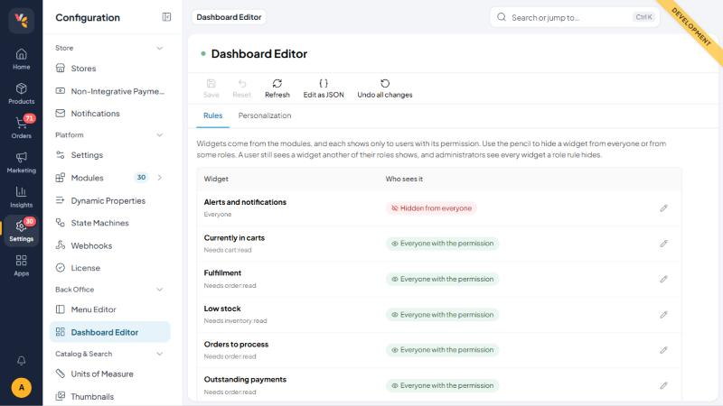
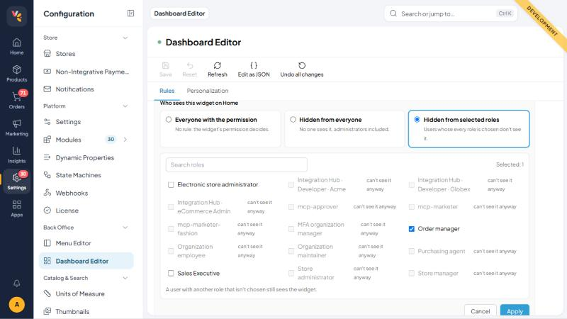
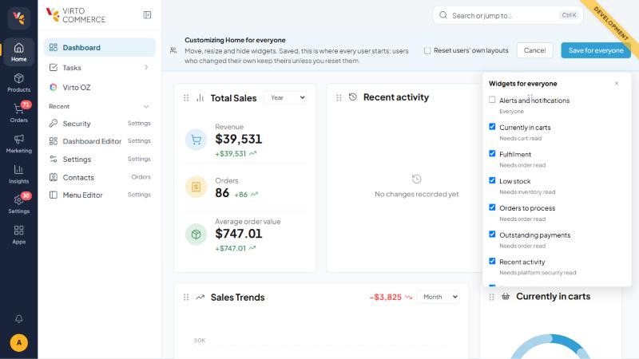
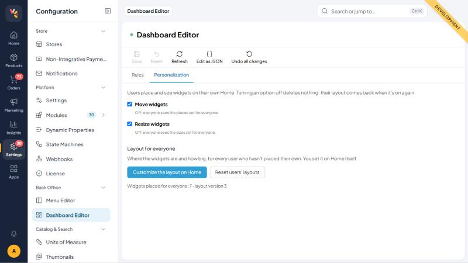
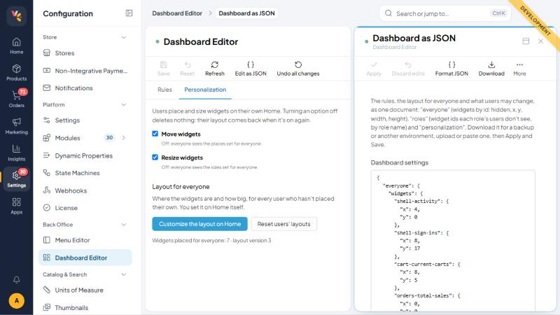

# Dashboard Widgets — Developer and Administrator Guide

## Overview

The Admin Shell's home page is a dashboard of widgets on a 12-column grid. Users drag, resize and reset them, and their layout is saved for them on the server. Administrators decide in the Dashboard Editor which widgets each role sees and where the widgets are for everyone (see *Layers* and *Scenarios* below). The shell adds the platform's widgets (alerts, recent activity, sign-ins); each module adds its own from its plugin with vc-shell's `registerDashboardWidget`. Today Orders adds sales, recent orders, orders to process, payments and fulfilment, Inventory adds *Low stock*, and Cart adds *Currently in carts*.

Source: `src/VirtoCommerce.AdminShell.Web/App/src/pages/Dashboard.vue` (the page), `src/shell/dashboard/` (the host's widgets and the planned layout), `src/styles/custom.scss` (`.dash-*` classes). Example plugin widget: `vc-module-inventory/src/VirtoCommerce.InventoryModule.Web/vue/src/modules/dashboard/`.

## Quick start

```ts
// src/modules/dashboard/index.ts — imported from the plugin's entry: import "./dashboard";
import { registerDashboardWidget } from "@vc-shell/framework";
import { markRaw } from "vue";
import LowStockWidget from "./LowStockWidget.vue";

registerDashboardWidget({
  id: "inventory-low-stock",          // unique, prefixed with the module
  name: "Low stock",                  // shown in vc-shell's widget lists
  component: markRaw(LowStockWidget),
  size: { width: 8, height: 6 },      // grid cells: 12 columns, rows of 80 px
  position: { x: 0, y: 16 },          // see "Positions"
  permissions: ["inventory:read"],    // hidden from users without it
});
```

```vue
<!-- LowStockWidget.vue -->
<template>
  <DashboardWidgetCard :header="$t('INVENTORY.DASHBOARD.LOW_STOCK.TITLE')" icon="lucide-clipboard-check" :loading="loading">
    <template #actions>
      <button type="button" class="dash-link-button" @click="openList">{{ $t("INVENTORY.DASHBOARD.VIEW_ALL") }}</button>
    </template>
    <template #content>
      <div v-if="rows.length" class="dash-table">
        <table>…</table>
      </div>
      <div v-else-if="!loading" class="dash-empty">
        <VcIcon icon="lucide-boxes" size="xl" />
        {{ $t("INVENTORY.DASHBOARD.LOW_STOCK.EMPTY") }}
      </div>
    </template>
  </DashboardWidgetCard>
</template>

<script lang="ts" setup>
import { DashboardWidgetCard, useAsync, useBlade } from "@vc-shell/framework";
import { VcIcon } from "@vc-shell/framework/ui";
import { onMounted } from "vue";

const { openBlade } = useBlade();
const { loading, action: load } = useAsync(async () => { /* fetch with the module's API client */ }, { notify: false });
onMounted(load);

// "View all": the module's workspace, as the menu opens it
const openList = () => openBlade({ name: "InventoryFulfillmentCenterList", isWorkspace: true });
</script>
```

Register widgets **at import** of the plugin's entry (not in a component), so they exist when the dashboard is built.

## Widget reference (`DashboardWidget`)

| Property | Type | Description |
|---|---|---|
| `id` | string | Required, unique. Prefix with the module (`orders-recent`). Saved layouts refer to it: changing it puts the widget back at its default position for everyone. |
| `name` | string | Required. A readable name. |
| `component` | Component | Required. Wrap with `markRaw`. |
| `size` | `{ width, height }` | Required. Grid cells; `width` out of 12, `height` in rows of 80 px. |
| `position` | `{ x, y }` | Default position. See below. |
| `permissions` | string[] | Checked with vc-shell's `hasAccess`; users without them don't see the widget. Give the one permission the data needs (`inventory:read`). |
| `props` | object | Props passed to the component. |

### `DashboardWidgetCard`

The card every widget uses: `header` (text), `icon` (`lucide-*`), `loading` (spinner over the content); slots `#actions` (top right, e.g. *View all*, a period select) and `#content`.

## Positions

vc-shell honours declared positions only when **every** widget declares one; otherwise it packs widgets automatically. Always declare `position`, and pick a free spot in the planned layout (`src/shell/dashboard/index.ts`):

```
y0   alerts (7)          | activity (5)                       [shell]
y5   total sales (4)     | sales trends (8)                   [orders]
y10  recent orders (8)   | currently in carts (4)             [orders | cart]
y16  low stock (8)       | orders to process (4)              [inventory | orders]
y22  payments (5) | sign-ins (4) | fulfillment (3)            [orders | shell | orders]
```

Add a new row below the last one (y27 and down) rather than squeezing into a row; update the comment in `src/shell/dashboard/index.ts` when you take a spot.

How the layout behaves:

- **The layers decide** which widgets show, where and how big (see *Layers* below). A widget no layer names takes its declared position and size, so a new module's widget shows up on its own.
- **The user's layout is kept on the server** (`AdminShell.Dashboard.User`), so it is the same in every browser. vc-shell's grid still reads and writes `localStorage["vc-dashboard-layout"]`; Home fills it from the server before the grid starts and saves the grid's changes back.
- **Closing up.** After the user's own move, the widgets close up in reading order, so no holes stay.
- **Reset layout** (top right) puts every widget back at its place for everyone.
- **Phones:** widgets are stacked full width in registration order (the host's first, then the plugins' as they load), not in grid order.

## Layers

The dashboard is composed like the menu ([menu-layers.md](menu-layers.md)). Each layer names widgets by id and only what it changes:

```
widgets the modules register ──► for everyone ──► roles ──► the user's own ──► the widgets' permissions ──► Home
(id, size, position,             (hide; place    (hide)    (place, size)      (checked by vc-shell: a widget
 permissions)                     and size)                                     the user may not see never shows)
```

| Layer | Platform setting | Who changes it | API (`/api/admin-shell/dashboard`) |
|---|---|---|---|
| For everyone | `AdminShell.Dashboard.Global` | `admin-shell:dashboard:manage`: *Customize for everyone* on Home, the Dashboard Editor's rules | `GET` / `PUT /global` (`?resetUserLayouts=true`) |
| Role | `AdminShell.Dashboard.Role` (tenant `Role`) | `admin-shell:dashboard:manage`: the Dashboard Editor's rules | `GET /roles` (every role with its permissions and rules, the editor's one request), `GET` / `PUT /roles/{roleId}` (404 for a role that doesn't exist) |
| User | `AdminShell.Dashboard.User` (tenant `UserProfile`, hidden) | the user, on Home | `GET` / `PUT /me` |
| What users may change | `AdminShell.Dashboard.AllowMove`, `.AllowResize` | the Dashboard Editor's *Layout* | `GET` / `PUT /personalization` |

`GET /api/admin-shell/dashboard` returns the user's dashboard with the layers composed.

A layer's value, e.g. the one for everyone:

```json
{
  "widgets": {
    "shell-alerts": { "x": 0, "y": 0, "width": 12, "height": 4 },
    "shell-sign-ins": { "hidden": true }
  },
  "layoutVersion": 2
}
```

Rules:

- **Permissions first, unchanged.** A widget shows only to users with its `permissions`; no layer can show it to others. Hiding is not security: the widget's data stays protected by its endpoints.
- **For everyone** hides a widget from every user, administrators too, and sets places and sizes. It is what every user starts from.
- **Roles:** a widget is hidden only when **every** one of the user's roles hides it, as for menu items. Administrators and users without roles get nothing hidden by roles. A role's earlier format, `{"hiddenWidgets": [...]}`, still reads.
- **The user** moves and resizes widgets, as far as the settings allow; users don't hide widgets (only everyone and role rules do). Turning a setting off deletes nothing: the user's layout applies again when it is on.
- **Reset users' layouts** (when saving for everyone, or in the configurator) raises `layoutVersion`; a user's places and sizes made under an older version are dropped at the next visit.
- **Diff only.** Saving for everyone keeps only what differs from the modules' own place and size, and a user's layer only what differs from the layout for everyone, so a later change of a default reaches the widgets nobody placed. Ids of widgets that aren't installed are kept and do nothing.
- A value that doesn't read as a layer (edited by hand, with a typo) counts as empty: everyone then sees every widget their permissions allow. A `PUT` whose body doesn't bind is refused with 400 and the layer is kept.

### Customize for everyone (Home)

Users with `admin-shell:dashboard:manage` see *Customize for everyone* on Home. It shows every installed widget at its place for everyone, to move and resize; *Widgets* hides or shows a widget for everyone, with the permission each needs. *Modules' layout* goes back to the modules' own places and sizes. *Save for everyone* stores the layer; *Reset users' own layouts* also drops every user's places and sizes. *Cancel* leaves without saving.

### The Dashboard Editor (Configuration › Back Office › Dashboard Editor)

Route `/dashboard-configurator`, permission `admin-shell:dashboard:manage`. It sits with the Menu Editor in the *Back Office* group.

| Tab | What it does |
|---|---|
| Rules | Every widget, with the permission it needs (*Everyone* for one that needs none) and who it is hidden from. The pencil opens the widget's rule below its row: show it to everyone with the permission, hide it from everyone, or hide it from selected roles (searchable; a role without the widget's permission is greyed out, its users don't see it anyway). *Apply* keeps the rule; *Save* writes the layers the rules touched. A new kind of scope (an account type, a user) is one more option here. |
| Personalization | What users may change (move, resize), as in the Menu Editor; the layout for everyone: *Customize the layout on Home*, *Reset users' layouts*. |

The toolbar, as the Menu Editor's: *Save*, *Reset*, *Refresh*, *Edit as JSON* and *Undo all changes*.

- *Edit as JSON* opens the editor's settings as one document beside it, to download for a backup or another environment, upload or paste, then *Apply* (the editor shows the result) and *Save*:

  ```json
  {
    "everyone": { "widgets": { "shell-alerts": { "hidden": true }, "orders-recent": { "x": 0, "y": 10, "width": 12 } } },
    "roles": { "Order manager": ["orders-to-process"] },
    "personalization": { "allowMove": true, "allowResize": true }
  }
  ```

  Roles are named, not by id, since ids differ between environments; a document naming a role that isn't there is refused.
- *Undo all changes* drops every rule and the layout for everyone, and lets users move and resize again; *Save* stores it.

### Scenarios

Step by step, for an administrator or a system integrator with `admin-shell:dashboard:manage`. Each scenario says what the users of the role then see.



#### 1. Hide a widget a role doesn't need

*Alerts and Notifications* is always empty for a role that runs no background jobs, imports or exports.

1. Open *Configuration › Back Office › Dashboard Editor*.
2. On *Rules*, find the widget and click its pencil.
3. Choose *Hidden from selected roles*, search for the role and tick it. A role without the widget's permission is greyed out: its users don't see the widget anyway.
4. *Apply*, then *Save* in the toolbar.

The role's users no longer see the widget, and the others close up. A user who also has a role that doesn't hide it still sees it, and so do administrators.



#### 2. Hide a widget from everyone

As in scenario 1, choose *Hidden from everyone*. Nobody sees the widget, administrators included. Choose *Everyone with the permission* to show it again.

#### 3. Lay out Home for everyone

1. On Home, click *Customize for everyone* (or *Customize the layout on Home* on the editor's *Personalization* tab).
2. Move and resize the widgets. *Widgets* shows each widget with its permission, to hide or show it for everyone; *Modules' layout* starts again from the modules' own places.
3. *Save for everyone*. Tick *Reset users' own layouts* to also drop the places and sizes users set for themselves.

Users who never moved anything see the new layout at once; with the reset, everyone does at their next visit.



#### 4. Decide what users may change

On *Personalization*, turn off *Move widgets* or *Resize widgets* and *Save*. Users then see the places or sizes set for everyone, and their own come back when the option is on again. Users never hide widgets: only the rules do.



#### 5. Move the setup to another environment

1. *Edit as JSON* in the toolbar, then *Download*.
2. On the other environment, open the Dashboard Editor, *Edit as JSON*, *Upload* the file, *Apply*, check the rules, then *Save*.

Roles are matched by name; a document naming a role that isn't there is refused.



#### 6. Start over

*Undo all changes* in the toolbar removes every rule and the layout for everyone and lets users move and resize again; *Save* stores it. *Reset* drops unsaved changes instead.

#### What a user does

A user moves and resizes widgets on Home; the layout is saved for the user and is the same in every browser. *Reset layout* appears once the user has changed something, and puts every widget back at its place for everyone.

## Shared styles (`.dash-*`)

Use these classes for a widget that looks like the others in both themes (defined in `src/styles/custom.scss`):

| Class | For |
|---|---|
| `.dash-link-button` | The *View all* link in `#actions`. |
| `.dash-select` | A small select in `#actions` (period). |
| `.dash-table` | A full-bleed table: `tr.dash-table__row--link` (clickable row), `.dash-table__num` (right-aligned numbers), `.dash-table__strong`, `.dash-table__muted`. |
| `.dash-link` | A link-coloured value (order number). |
| `.dash-empty` | The empty state: icon and text centred in the card. |
| `.dash-inline` | Lets a block component (`VcStatus`) size to its content in a cell. |
| `.dash-metrics`, `.dash-metric` (`__icon--blue\|amber\|green`, `__label`, `__value`, `__line`), `.dash-delta` (`--down`) | Key figures with a change indicator. |
| `.dash-feed` (`__item`, `__dot`, `__title`, `__text`, `__meta`) | An activity list. |
| `.dash-alerts`, `.dash-alert` (`--success\|--danger`), `.dash-dismiss` | Alerts with a dismiss button. |
| `.dash-donut` (`__chart`, `__center`, `__total`, `__legend`, …) | A donut with a legend. |
| `.dash-bars` (`__bar`, `__track`, `__fill`, `__value`, `__chip`, `__legend`) | Vertical percentage bars. |
| `.dash-count` | A count pill next to the actions. |

Styles that only one widget needs go into the widget's own `<style scoped>`. Use the design tokens (`--color-neutral-600`, `--bg-*`, …) rather than fixed colours.

## Guidelines

- One request per widget, small `take`; a dashboard opens many widgets at once. Use `useAsync(…, { notify: false })`: the app's error handler shows a failure once.
- Open the module's screens from the widget the way the menu does (`openBlade({ name, isWorkspace: true })`, then the detail blade), so the blade stack is the same.
- Keep content to what fits the card at its size: one line per row, full text in `title`. Check at phone width, where the card is narrower; a container query (`container-type: inline-size`) lets the widget adapt to its own width.
- A widget belongs to the module whose data it shows, in that module's plugin, so it comes and goes with the module. A module without screens can have a plugin just for its widgets (Cart's plugin brings only *Currently in carts*).

## Testing

- The widget shows for a user with the permission and not for one without.
- Clear `localStorage["vc-dashboard-layout"]` (a first visit): the widget is at its declared position and doesn't push others.
- Move a widget, reload (the layout is kept, in another browser too), then *Reset layout* (all back to the defaults).
- Add a rule hiding the widget from a role and sign in as a user with only that role: it is gone, and the others close up.
- Light and dark themes; a phone-sized window.
