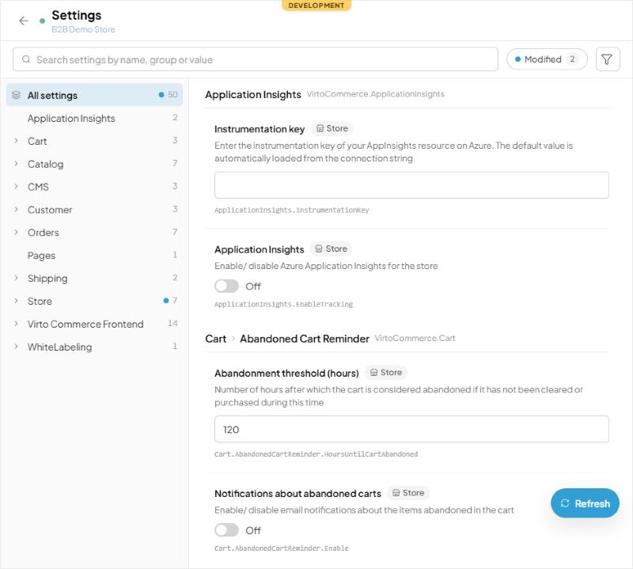

# Object Settings — Developer Guide

## Overview

A module that has settings per object (a store's, a catalog's) doesn't need a settings editor of its own. It opens the Admin Shell's settings blade for that object: the same tree of groups, editors, search and "modified" markers as the Settings workspace, scoped to the object. This is the AngularJS unified settings blade's tenant and entity modes (`settings-unified.js`):

| Mode | Reads | Saves | Permissions |
|---|---|---|---|
| `connected` | the entity's own settings (`ObjectSettingEntry[]`, e.g. `Store.settings`), from the blade that opened it | gives the changed values back to that blade; its entity saves them | the entity's (e.g. `store:update`); no settings permission |
| `disconnected` | `GET api/platform/settings/v2/tenant/{tenantType}/{tenantId}/values` and `…/tenant/{tenantType}/schema` | `POST api/platform/settings/v2/tenant/{tenantType}/{tenantId}/values` | `platform:setting:query`, `platform:setting:update` |

The blade is the host's (`PlatformObjectSettings`), opened by name, so the module ships no settings UI and needs no npm package: it gets every change to the blade with the Admin Shell.



Source: `src/modules/platform/pages/settings/object-settings.vue` (the blade), `list.vue` (the editor, `ObjectSettingsOptions`), `src/modules/platform/composables/settings.ts` (`SettingsScope`).

## Connected (saved with the entity)

The entity's blade exposes two methods to its children and opens the settings blade:

```ts
const { openBlade, exposeToChildren } = useBlade();

exposeToChildren({
  // the entity's settings, as the API returns them with the entity
  getEntitySettings: () => clone(item.value.settings ?? []),
  // the changed values, { "Stores.TaxCalculationEnabled": false }: put them into the entity's settings and save it
  async applyEntitySettings(values: Record<string, unknown>) {
    const settings = (item.value.settings ?? []).map((s) => (s.name! in values ? { ...s, value: values[s.name!] } : s));
    await saveEntity({ ...item.value, settings });
  },
});

openBlade({
  name: "PlatformObjectSettings",
  options: {
    tenantType: "Store",
    tenantId: item.value.id,
    mode: "connected",
    canUpdate: hasAccess("store:update"),
    title: t("STORES.WIDGETS.SETTINGS"),
    subtitle: item.value.name,
  },
}).catch(() => openBlade({ name: "MyOwnSettingsBlade", param: item.value.id })); // an Admin Shell without it
```

`applyEntitySettings` decides how the entity saves: at once (the Store module saves the store's settings part), or into the entity's unsaved edits for the entity's own Save, as the AngularJS entity blade did. After it returns, the settings blade reads `getEntitySettings` again.

## Disconnected (the blade loads and saves)

```ts
openBlade({
  name: "PlatformObjectSettings",
  options: { tenantType: "Catalog", tenantId: catalog.id, mode: "disconnected", title: t("CATALOG.SETTINGS"), subtitle: catalog.name },
});
```

Nothing is exposed: the blade reads and saves through the tenant API. Use it for settings that are not part of an entity the module saves. An entity that carries its settings and caches itself (the Store module's store) keeps serving its cached copy after a tenant save until the cache is reset, and its own Save can then write the old values back: such an entity uses `connected`.

## Options

| Option | Type | Description |
|---|---|---|
| `tenantType` | string | Required. The settings' tenant type, as the module registers them (`Store`, `Catalog`). |
| `tenantId` | string | Required for `disconnected`: the object's id. |
| `mode` | `"connected"` \| `"disconnected"` | Required. |
| `canUpdate` | boolean | `connected`: `false` shows the settings read-only. `disconnected` follows `platform:setting:update`. |
| `title`, `subtitle` | string | The blade's head. Default title: "Settings". |

The blade hides what belongs to the global settings only: export, import, the JSON editor, the cache reset, the "tenant settings" filter, links to a group, and editing a dictionary's values (those are global).

## Testing

- Connected: open the settings from the entity, change a value, Save: the entity's API is called, the entity shows the value, the blade marks it modified; Reset and leaving with unsaved edits ask first.
- Disconnected: change a value, Save: `POST …/tenant/{type}/{id}/values` with only that value; Refresh shows it.
- A user without the entity's update permission (connected) or `platform:setting:update` (disconnected): the editors are read-only and Save is disabled.
- The Settings workspace (`#/settings`) is unchanged: export, import, JSON, cache, tenant filter, links.
