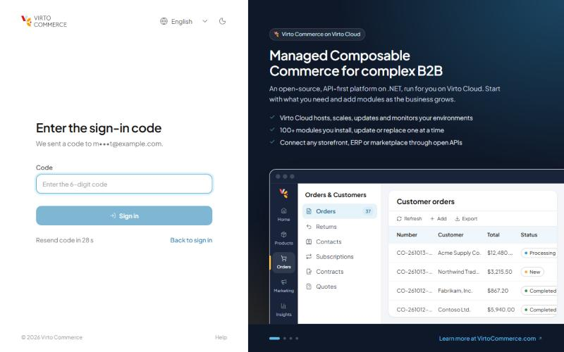
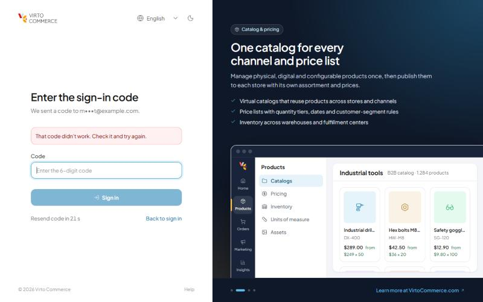
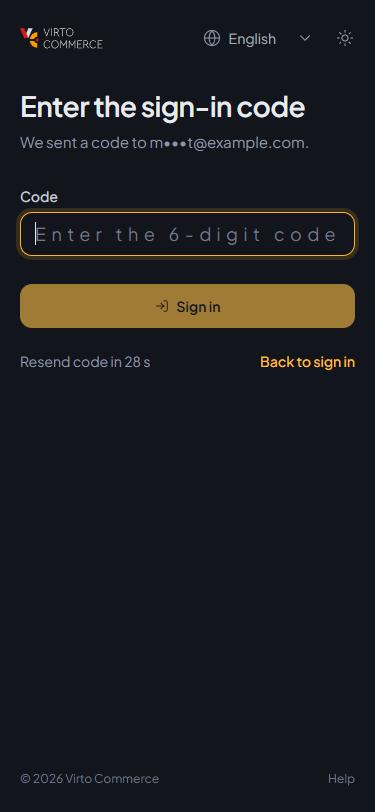
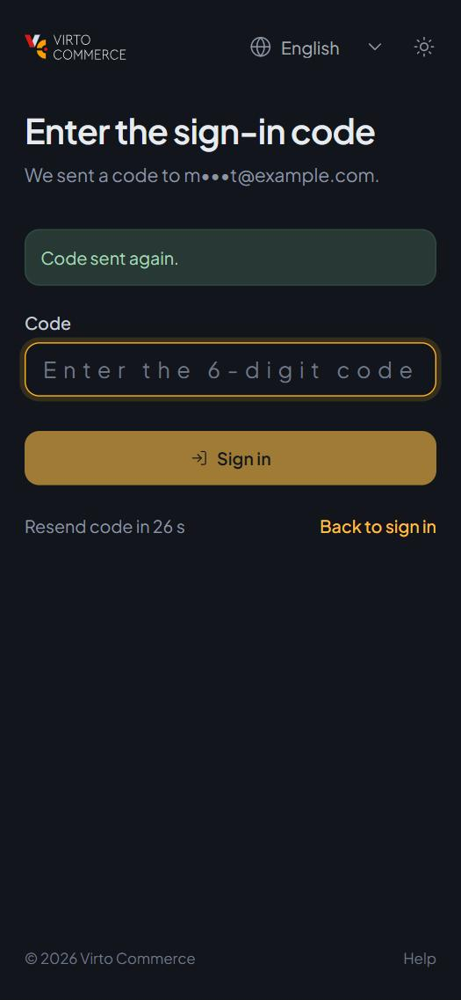
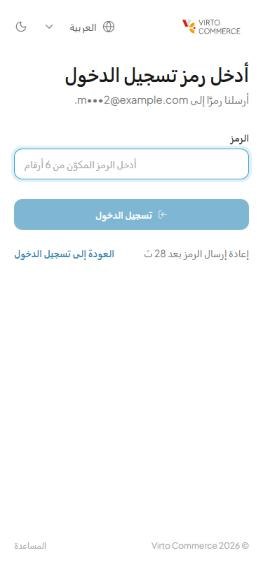

# Sign-in Page — Developer Guide

## Overview

The Admin Shell has its own sign-in page (`#/login`): the password form, the external sign-in providers configured on the platform (Microsoft, Google, other SSO), and a showcase panel beside the form. A module can add content **below the sign-in form** — a registration link, a notice, a help button — through vc-shell's extension point `auth:after-form`, the same point vc-shell's own sign-in page has, so a plugin written for another vc-shell app works here too.

Source: `src/VirtoCommerce.AdminShell.Web/App/src/pages/Login.vue` (`<ExtensionPoint name="auth:after-form" />`), `src/pages/AuthShell.vue` (the page frame).

When multi-factor authentication is on, a password sign-in continues on a second page, the [sign-in code](#second-sign-in-step-multi-factor-authentication) — part of the shell, not an extension.

## Quick start

In the plugin's `install`:

```ts
import { useExtensionPoint } from "@vc-shell/framework/extensions";
import { markRaw } from "vue";
import RequestAccessLink from "./components/RequestAccessLink.vue";

export default {
  install(app: App) {
    appModule.install(app);
    useExtensionPoint("auth:after-form").add({
      id: "my-module.request-access",    // unique; adding the same id again replaces it
      component: markRaw(RequestAccessLink),
      props: { href: "https://example.com/request-access" },
      priority: 10,                      // lower first
    });
  },
};
```

The component renders under the form, inside the sign-in card. Use vc-shell components (`VcButton`, `VcLink`) and the design tokens so it fits both themes.

## Reference

`useExtensionPoint(name)` returns `{ add(entry), remove(id) }`.

| Entry field | Type | Description |
|---|---|---|
| `id` | string | Required, unique. Prefix with the module. |
| `component` | Component | Required. Wrap with `markRaw`. |
| `props` | object | Props passed to the component. |
| `priority` | number | Order among the entries, lower first. Default `0`. |
| `meta` | object | Free metadata (e.g. `{ type: "action" }`). |

## When it runs

Plugins are loaded from the app manifest, which the platform serves without sign-in, so the extension is there before the user signs in. The user isn't known yet: the component mustn't call APIs that need authentication.

## Guidelines

- Keep it to one short line or button; the page is a sign-in form first.
- Don't collect credentials in the extension; send the user to the platform's own flows (password reset, external providers).
- Remove the entry (`remove(id)`) if the feature it links to is turned off.

## Testing

- Sign out, open `#/login`: the content shows under the form in light and dark themes and at phone width.
- A failed sign-in and the external providers still work around it.

## Second sign-in step (multi-factor authentication)

With [vc-module-mfa](https://github.com/VirtoCommerce/vc-module-mfa) installed and `MultiFactorAuthentication.Enabled` on (Settings > Platform > Security), a password sign-in needs a one-time code sent by email. The Admin Shell does this itself, as the main admin must ([requirements, section 7.10](admin-ui-requirements.md#710-sign-in-and-multi-factor-authentication)); modules don't extend it.

Source: `src/pages/TwoFactorSignIn.vue` (route `TwoFactorSignIn`, `#/sign-in-code`), `src/shell/signIn.ts` (where a finished sign-in goes, shared with `Login.vue`), texts under `SHELL.MFA` in `src/locales/*.json` (the module's own wording).

```text
Login.vue  ── signIn(user, password) ──▶ POST api/platform/security/login
   │                                       { requiresTwoFactor: true }  (+ two-factor cookie)
   ▼
TwoFactorSignIn.vue
   ├─ on open, "Resend code" ──▶ POST api/mfa/signin/send    { provider, providers[].destination, resendSecondsRemaining }
   └─ Sign in               ──▶ POST api/mfa/signin/verify  { succeeded }  (session cookie)
   ▼
loadUser() → goAfterSignIn(): access denied | forced password change | deep link | Home
```

- The page asks for a code as it opens and shows the masked address the module returns. "Resend code" waits the seconds the module reports, with a countdown.
- `invalid_code` clears the field and keeps the step. Every other error code is final: its message and "Back to sign in" only. A `404` from `api/mfa` means the module isn't installed: "a second sign-in step is required but not available".
- The session is the platform's cookie, as after an external sign-in: no token is requested with the password afterwards, which would need a second code.
- The AngularJS admin keeps the module's own code screen; both admins share the session, so a user signed in through one is signed in to the other.

| The code step | A wrong code |
|---|---|
|  |  |

| Phone | Code sent again | Arabic (right to left) |
|---|---|---|
|  |  |  |

**Testing.** On a platform with the module (platform 3.1090.0 or later), turn MFA on and give the test user a confirmed email and lockout enabled (the account blade's switches). Then, in light and dark, at phone width, and in a right-to-left language:

- Sign in with the password: the code page opens and an email arrives. Without an SMTP server, the code is in the notification log (the message is stored before it is sent).
- A wrong code: an error, the field cleared. Too many wrong codes: the final message and "Back to sign in" only.
- Wait for the countdown and "Resend code": "Code sent again", a new countdown.
- The right code: Home, or the deep link the user opened; the AngularJS screens open signed in.
- With MFA off: the password signs in directly.
